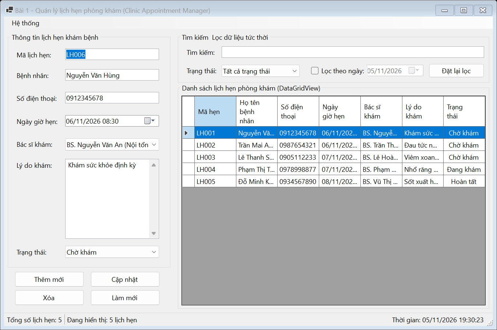
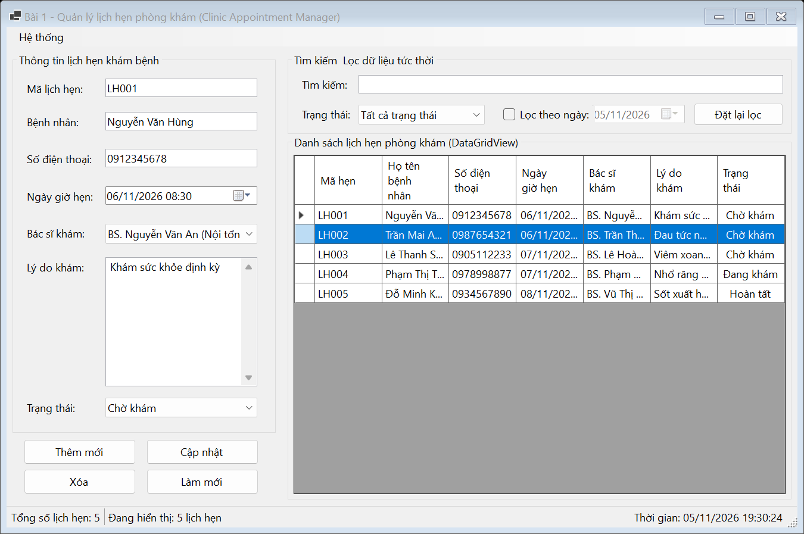
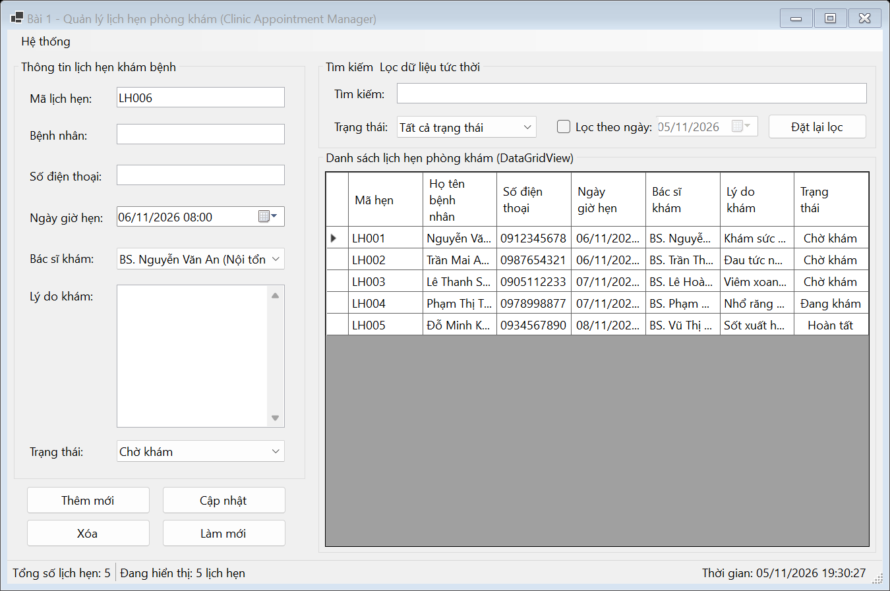

# BÁO CÁO BÀI TẬP / ĐỒ ÁN

## THÔNG TIN SINH VIÊN
- **Họ và tên:** Lê Thị Thúy Hiền
- **Mã số sinh viên:** 24810301243
- **Lớp:** D19CNPM3
- **Tên môn học:** Lập trình C# / Windows Forms
- **Tên bài tập:** BÀI 4.9: Quản lý lịch hẹn phòng khám (Clinic Appointment Manager)

---

## MÔ TẢ TÍNH NĂNG
1. **Quản lý danh sách lịch hẹn:**
   - Hiển thị danh sách lịch hẹn khám bệnh trực quan trên DataGridView.
   - Hỗ trợ thêm mới, cập nhật thông tin và xóa lịch hẹn có hộp thoại xác nhận.
   - Tự động sinh mã lịch hẹn (LH001, LH002,...).
2. **Tìm kiếm & Bộ lọc linh hoạt:**
   - Tìm kiếm tức thời (real-time) theo Mã lịch hẹn, Tên bệnh nhân hoặc Số điện thoại.
   - Lọc theo Bác sĩ phụ trách, Trạng thái (Chờ khám, Đã khám, Đã hủy) hoặc Lọc theo ngày hẹn.
3. **Kiểm tra dữ liệu (Validation):**
   - Sử dụng `ErrorProvider` để kiểm tra tính hợp lệ: Tên bệnh nhân, Số điện thoại (9-11 số), Bác sĩ, Lý do khám.
4. **Thanh trạng thái & Tiện ích:**
   - Hiển thị tổng số lịch hẹn và số lượng đang hiển thị theo bộ lọc trên `StatusStrip`.
   - Đồng hồ thời gian thực cập nhật từng giây.
   - Xuất danh sách ra tệp tin CSV (UTF-8) thông qua MenuStrip.

---

## KẾT QUẢ THỰC HÀNH

### 1. Ảnh màn hình Giao diện chính

### 2. Ảnh màn hình Chức năng thực thi / Kết quả

### 3. Ảnh màn hình Kiểm tra lỗi (Validation)

