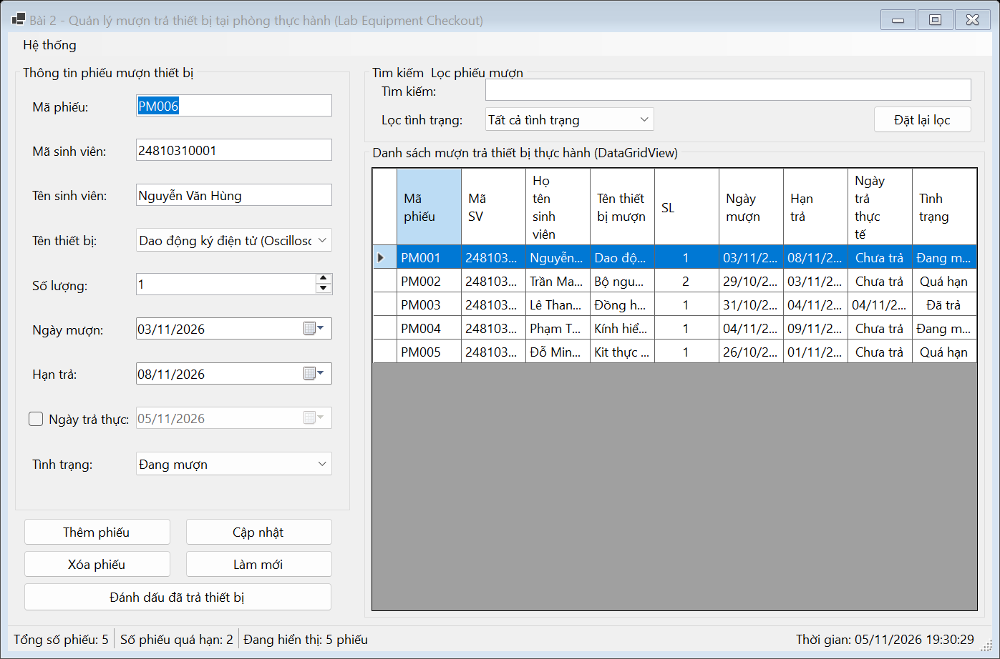
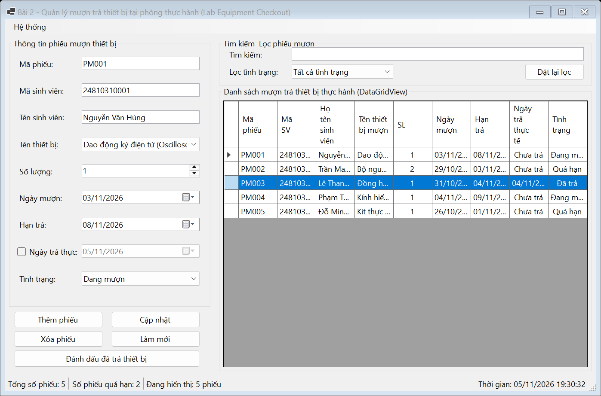
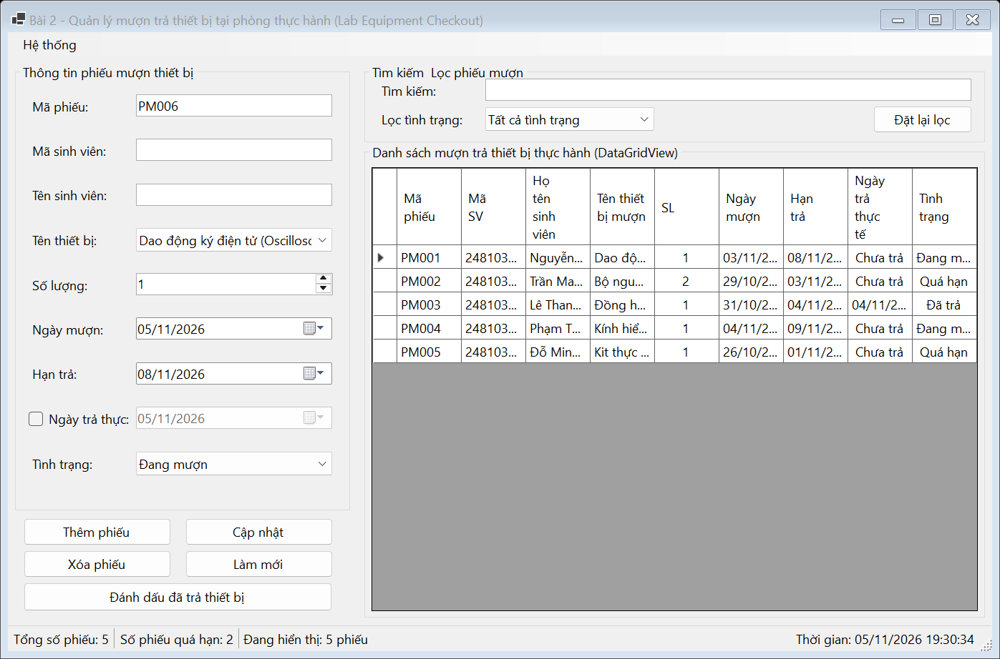

# BÁO CÁO BÀI TẬP / ĐỒ ÁN

## THÔNG TIN SINH VIÊN
- **Họ và tên:** Lê Thị Thúy Hiền
- **Mã số sinh viên:** 24810301243
- **Lớp:** D19CNPM3
- **Tên môn học:** Lập trình C# / Windows Forms
- **Tên bài tập:** BÀI 4.10: Quản lý mượn trả thiết bị tại phòng thực hành (Lab Equipment Checkout)

---

## MÔ TẢ TÍNH NĂNG
1. **Quản lý mượn trả thiết bị:**
   - Quản lý danh sách phiếu mượn thiết bị phòng lab trên DataGridView.
   - Hỗ trợ thêm phiếu mượn, cập nhật phiếu mượn, xóa phiếu mượn với hộp thoại xác nhận.
   - Nút chức năng nhanh: "Đánh dấu đã trả thiết bị" tự động ghi nhận ngày trả thực tế và cập nhật trạng thái.
2. **Tự động tính toán & Cảnh báo quá hạn:**
   - So sánh ngày hẹn trả với ngày hiện tại để tự động chuyển trạng thái thành "Quá hạn" đối với các phiếu chưa trả.
   - Thống kê tổng số phiếu, số phiếu quá hạn cần lưu ý trên `StatusStrip`.
3. **Tìm kiếm & Bộ lọc:**
   - Tìm kiếm tức thời theo Mã phiếu, Mã sinh viên, Tên sinh viên hoặc Tên thiết bị.
   - Lọc theo Trạng thái (Đang mượn, Đã trả, Quá hạn).
4. **Kiểm tra dữ liệu (Validation):**
   - Kiểm tra mã phiếu không trùng lặp, mã sinh viên, họ tên sinh viên, số lượng mượn (> 0), ngày hẹn trả phải từ ngày mượn trở đi.
5. **Tiện ích hệ thống:**
   - Menu xuất danh sách ra file CSV chuẩn UTF-8.
   - Đồng hồ thời gian thực trên thanh trạng thái.

---

## KẾT QUẢ THỰC HÀNH

### 1. Ảnh màn hình Giao diện chính

### 2. Ảnh màn hình Chức năng thực thi / Kết quả

### 3. Ảnh màn hình Kiểm tra lỗi (Validation)

