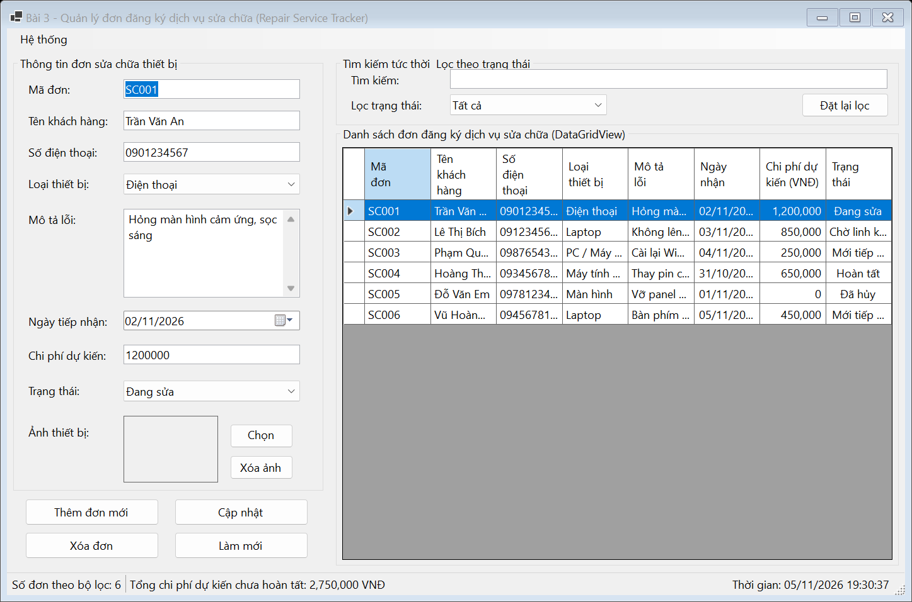
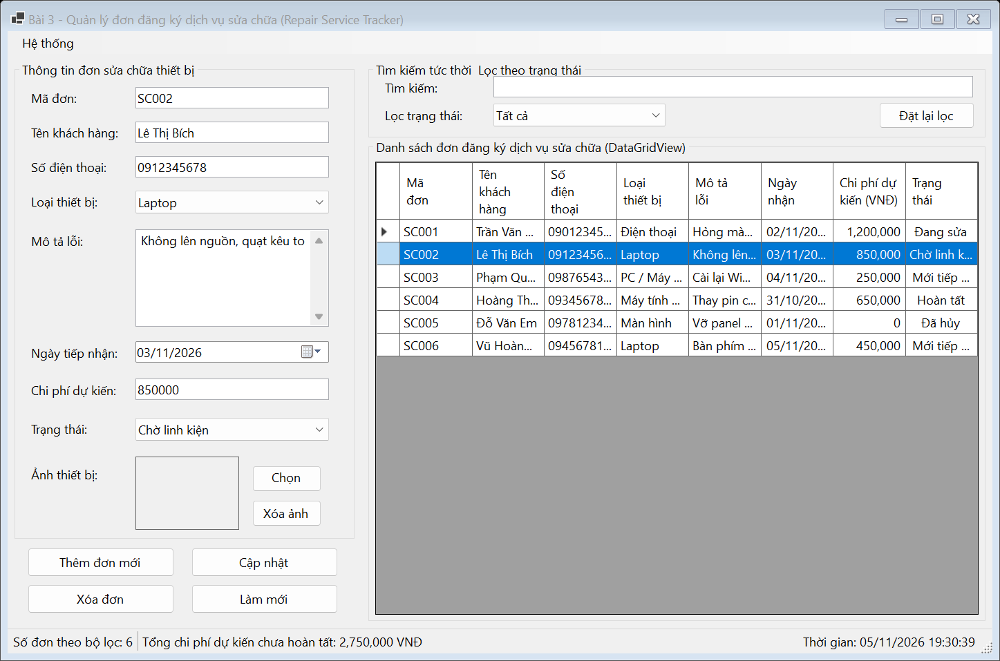
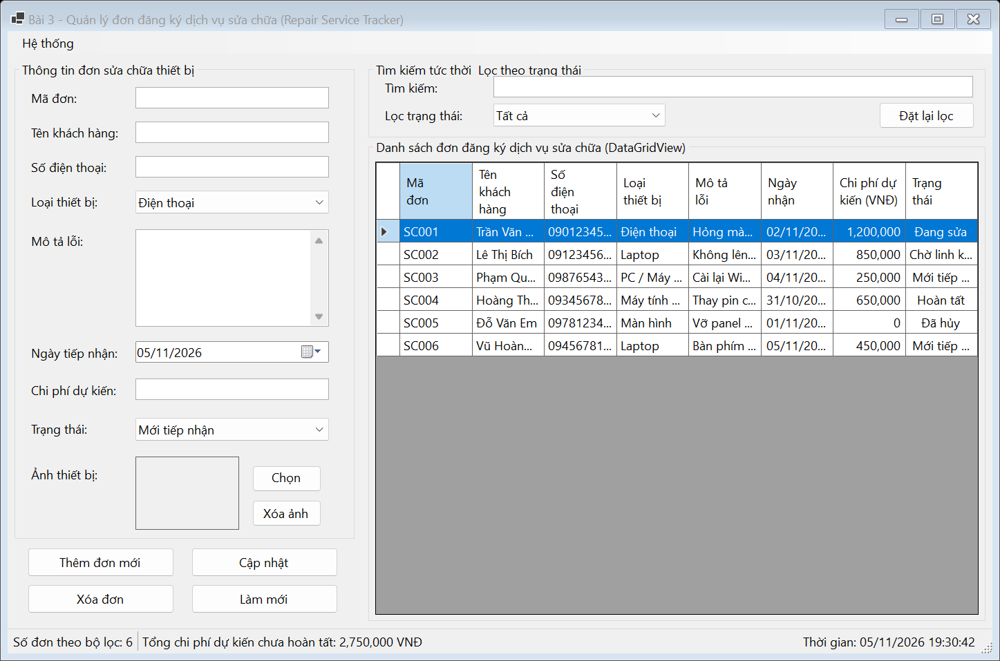

# BÁO CÁO BÀI TẬP / ĐỒ ÁN

## THÔNG TIN SINH VIÊN
- **Họ và tên:** Lê Thị Thúy Hiền
- **Mã số sinh viên:** 24810301243
- **Lớp:** D19CNPM3
- **Tên môn học:** Lập trình C# / Windows Forms
- **Tên bài tập:** BÀI 4.11: Quản lý đơn đăng ký dịch vụ sửa chữa (Repair Service Tracker)

---

## MÔ TẢ TÍNH NĂNG
1. **Quản lý đơn sửa chữa thiết bị:**
   - Quản lý danh sách đơn tiếp nhận sửa chữa với đầy đủ thông tin: Mã đơn, Khách hàng, Số điện thoại, Loại thiết bị, Mô tả lỗi, Ngày nhận, Chi phí dự kiến, Trạng thái.
   - Thêm mới, cập nhật, xóa đơn có xác nhận an toàn.
   - Định dạng chi phí theo tiền tệ (định dạng số `N0`, căn phải cột DataGridView).
2. **Xử lý ảnh thiết bị đính kèm:**
   - Sử dụng `PictureBox` với chế độ `SizeMode = PictureBoxSizeMode.Zoom` chống méo ảnh.
   - Nạp ảnh an toàn qua luồng (`FileStream`) không khóa tệp trên đĩa.
   - Nút chọn ảnh và xóa ảnh thiết bị linh hoạt.
3. **Tìm kiếm & Bộ lọc:**
   - Tìm kiếm tức thời theo Mã đơn, Khách hàng hoặc Số điện thoại.
   - Lọc theo Trạng thái (Mới tiếp nhận, Đang sửa, Chờ linh kiện, Hoàn tất, Đã hủy).
4. **Kiểm tra dữ liệu (Validation):**
   - Kiểm tra mã đơn không trùng lặp, thông tin khách hàng, số điện thoại đúng định dạng, chi phí dự kiến không âm.
5. **Thống kê & Thanh trạng thái:**
   - Tự động tính toán tổng chi phí dự kiến của các đơn đang xử lý (chưa hoàn tất và chưa hủy) hiển thị trên `StatusStrip`.
   - Xuất danh sách ra tệp CSV (UTF-8). Đồng hồ thời gian thực.

---

## KẾT QUẢ THỰC HÀNH

### 1. Ảnh màn hình Giao diện chính

### 2. Ảnh màn hình Chức năng thực thi / Kết quả

### 3. Ảnh màn hình Kiểm tra lỗi (Validation)

